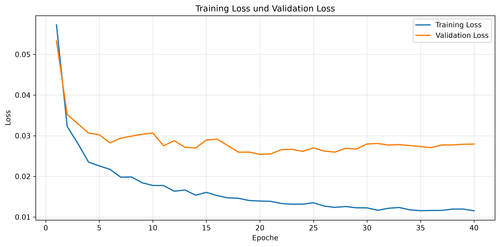

# artme-Filamentextruder

## Beschreibung

Ziel dieses Projekts ist die datenbasierte Vorhersage des Filamentdurchmessers eines Artme-Extruders mithilfe von Künstlicher Intelligenz. Dadurch soll der Key-Performance-Indikator Qualität verbessert werden, indem mehr Filament mit dem gewünschten Durchmesser produziert und gleichzeitig weniger Ausschuss erzeugt wird. Im Extrusionsprozess ist ein möglichst konstanter Durchmesser wichtig, da Abweichungen die Qualität des gedruckten oder weiterverarbeiteten Materials beeinflussen können. Das Projekt untersucht daher, ob aus Prozessdaten wie Temperatur, Extruder-Drehzahl, Puller-Drehzahl, Sensorposition und bisherigen Durchmesserwerten eine Vorhersage des zukünftigen Durchmessers möglich ist.

Im Kontext von Künstliche Intelligenz und Digitalisierung im Maschinenbau zeigt das Projekt, wie Messdaten aus einem technischen Prozess genutzt werden können, um Prozessverhalten zu analysieren und Qualitätsabweichungen frühzeitig zu erkennen. Eine solche Vorhersage kann perspektivisch dabei helfen, Regelungsstrategien zu verbessern oder Bedienpersonen rechtzeitig auf ungünstige Prozessentwicklungen hinzuweisen.

Als Datengrundlage werden aufgezeichnete CSV-Dateien des Extrusionsprozesses verwendet. Diese enthalten unter anderem den gemessenen Filamentdurchmesser, die aktuelle Temperatur, die Extruder-Drehzahl, die Puller-Drehzahl und die Sensorposition. Die Daten werden zunächst vorverarbeitet und für das Modell in eine geeignete Trainings- und Teststruktur überführt. Im aktuellen Modellstand werden keine zusätzlichen Trend-Features wie kurzfristige Änderungen oder Steigungen des Durchmessers ergänzt.

Für die Vorhersage wird ein Multi-Layer-Perceptron eingesetzt. Das Modell betrachtet Sequenzen vergangener Messwerte und sagt die Änderung des Durchmessers mehrere Zeilen in die Zukunft voraus. Die Hyperparameter des neuronalen Netzes werden mithilfe von Optuna optimiert. Anschließend werden das trainierte Modell, die verwendeten Scaler, die Trainingshistorie und ein Plot des Training- und Validation-Loss gespeichert.

Im aktuellen Branch wird ein MLP-Modell verwendet, das aus den vier Prozessgrößen Temperatur, Extruder-Drehzahl, Puller-Drehzahl und Sensorposition den Filamentdurchmesser abschätzt. Der aktuelle Trainingslauf erreicht einen finalen Validation Loss von `0.0554`, einen Test-MSE von `0.0583` und einen Test-MAE von `0.1570` im skalierten Zielraum. Rückgerechnet entspricht das einem mittleren absoluten Fehler von etwa `0.0110 mm`.

  

## Autor

- Simon Krüger
